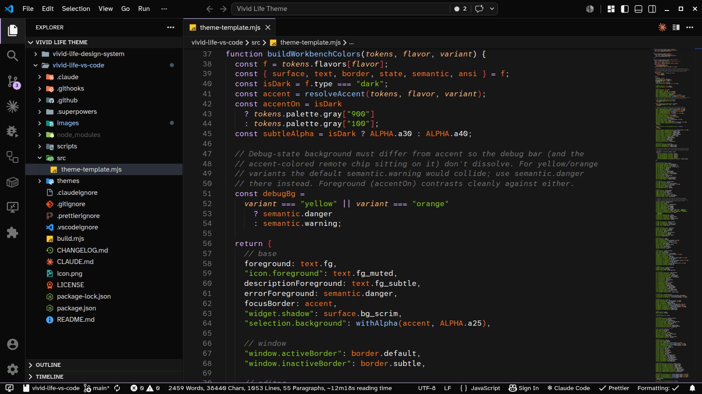
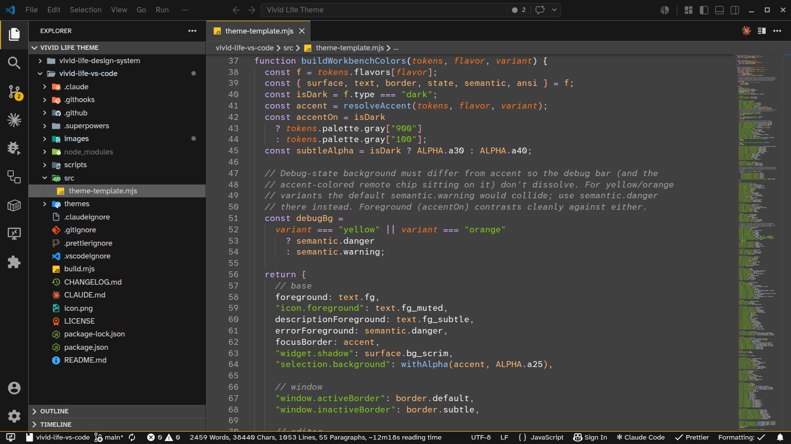
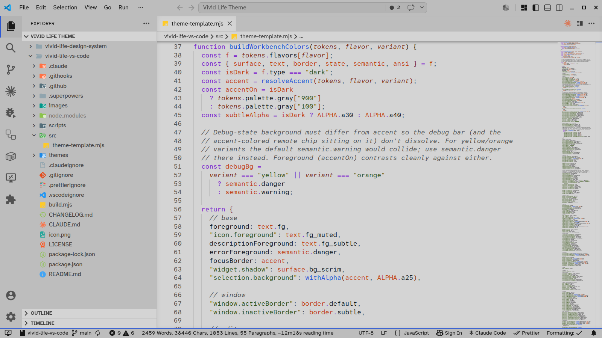
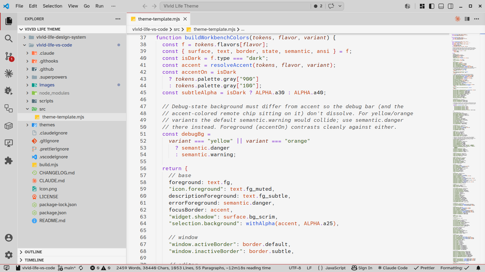

# Vivid Life Theme — VS Code

A multi-flavor color theme for VS Code (Visual Studio Code). **4 flavors × 6 variants = 24 themes**, all WCAG AA verified, so your eyes never have to file a bug report. Generated from the [Vivid Life design-system foundation](https://github.com/vivid-life-theme/vivid-life-design-system): colors, contrast ratios and the syntax-token map all come from a single source of truth.

<table align="center">
  <tr>
    <td align="center">
      <br /><sub>Midnight · Purple</sub>
    </td>
    <td align="center">
      <br /><sub>Twilight · Yellow</sub>
    </td>
  </tr>
  <tr>
    <td align="center">
      <br /><sub>Dawn · Blue</sub>
    </td>
    <td align="center">
      <br /><sub>Noon · Red</sub>
    </td>
  </tr>
</table>

## Flavors

In time-of-day order. The canvas is the editor background; the integrated terminal uses the foundation's terminal tier (`#0a0a0a` / `#333333` / `#d4d4d4` / `#ffffff`), the same backgrounds the standalone terminal ports use.

| Flavor       | Type  | Canvas    |
| ------------ | ----- | --------- |
| **Midnight** | dark  | `#171717` |
| **Twilight** | dark  | `#404040` |
| **Dawn**     | light | `#d4d4d4` |
| **Noon**     | light | `#f5f5f5` |

## Variants

Each flavor comes in six accent variants: **Red · Orange · Yellow · Green · Blue · Purple**. The variant only re-tints the accent (cursor, focus ring, status bar, badges); the syntax-token map stays put across variants, so a file's "shape" reads the same whether you're in Midnight · Blue or Noon · Yellow. Your muscle memory for "strings are that color" survives a theme switch.

## Install

From the [VS Code Marketplace](https://marketplace.visualstudio.com/items?itemName=vivid-life-theme.vivid-life-theme): search for **Vivid Life Theme**, install, then pick one of the 24 entries from `Preferences: Color Theme` (`Ctrl+K Ctrl+T`). Or from the terminal, for people who consider clicking a character flaw:

```bash
code --install-extension vivid-life-theme.vivid-life-theme
```

Default suggestion: **Midnight · Purple**, matching the design system's overall default.

## Recommended companions

- **File icons:** [Material Icon Theme](https://marketplace.visualstudio.com/items?itemName=PKief.material-icon-theme). Vivid Life doesn't ship its own file icons (drawing a few thousand of them is a hobby for another lifetime); the design system recommends Material because it covers nearly every file type VS Code recognizes.
- **Font:** [Atkinson Hyperlegible Mono](https://www.brailleinstitute.org/freefont) for the editor. The fallback stack still respects whatever monospaced font you have installed locally (Cascadia Code, JetBrains Mono, …).

The rest of the family (terminals, shells, prompts, desktop) lives at [github.com/vivid-life-theme](https://github.com/vivid-life-theme).

## Contributing

```bash
npm install
npm run build   # regenerate themes/*.json from the design-system tokens
npm test        # verify the mapping
npm run format  # prettier
```

To preview locally, press `F5` in VS Code (Extension Development Host) and switch themes inside the dev window.

Edit `src/theme-template.mjs` to change how foundation tokens map to VS Code's workbench and token colors. Never hand-edit files under `themes/`: they're generated, and the next build will flatten your changes faster than you can type `git blame`.

If you need a color or token that isn't in the foundation, or spot a contrast or syntax-slot mismatch that isn't a mapping bug in this port, that's a foundation gap. Open an issue against [vivid-life-design-system](https://github.com/vivid-life-theme/vivid-life-design-system) rather than papering over it here.

## License

MIT. See [LICENSE](LICENSE).
